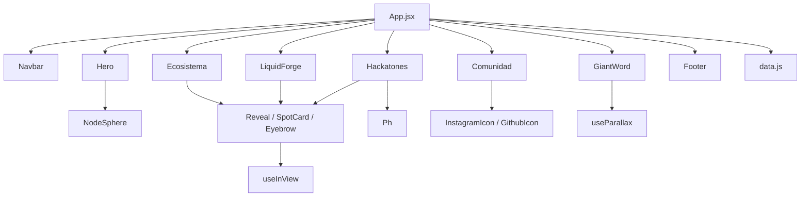

# Arquitectura

Documentación técnica de GexClub v2 después de la migración a Vite.

## Alcance

Incluye:

- Proyecto Vite con React 18, Tailwind CSS 3, lucide-react y Three.js 0.147.0.
- Componentes de la landing: hero, ecosistema, forja, hackatones, comunidad y footer.
- Datos editables centralizados y marcadores visuales para contenido pendiente.

No incluye:

- Sitio v0.4.0 publicado ni su flujo de deploy en Hostinger.
- Datos reales de la Edición 01 ni enlace de Discord; hoy hay valores `TEMP` marcados como provisionales.
- Configuración real de Formspree; el repositorio solo incluye `.env.example`.

## Estructura

```text
GexClub-v2/
├── index.html
├── .env.example
├── package.json
├── vite.config.js
├── tailwind.config.js
├── postcss.config.js
├── src/
│   ├── main.jsx
│   ├── App.jsx
│   ├── data.js
│   ├── hooks.js
│   ├── index.css
│   └── components/
│       ├── Primitives.jsx
│       ├── NodeSphere.jsx
│       ├── Navbar.jsx
│       ├── Hero.jsx
│       ├── Ecosistema.jsx
│       ├── LiquidForge.jsx
│       ├── Hackatones.jsx
│       ├── Comunidad.jsx
│       └── Footer.jsx
├── public/
│   └── brand/
│       └── gex-mark-dark-square.png
├── GexClubV2.jsx          # copia heredada, no canonical
├── preview.html           # copia heredada
├── gexclub-v2.html        # copia heredada
└── onix-t1.html           # demo heredada
```

## Componentes



| Módulo | Responsabilidad |
| --- | --- |
| `data.js` | `BRAND`, `LINKS`, `PAST_EDITION` y `NAV`. Único lugar para datos editables; hoy incluye valores `TEMP` y `photos`. |
| `hooks.js` | `useInView` y `useParallax`. |
| `Primitives.jsx` | `Ph`, `Reveal`, `SpotCard`, `Eyebrow`, `GiantWord`, `Logo` e iconos SVG locales. |
| `NodeSphere.jsx` | Esfera geodésica en Canvas 2D con dos capas y reacción al cursor/scroll. |
| `LiquidForge.jsx` | Escena Three.js controlada por scroll; incluye `FORGE_STAGES` y `createForge()`. |
| `Hackatones.jsx` | Radar en espera, formulario de alerta y archivo de la Edición 01 con modal. |
| `Comunidad.jsx` | Enlaces de comunidad. |
| `Footer.jsx` | Navegación secundaria y pie. |

## Flujo de datos

1. `src/data.js` expone constantes inmutables de configuración.
2. Los componentes consumen esas constantes directamente; no hay estado global.
3. `Ph` detecta cadenas que empiezan por `[` y las resalta en ámbar.
4. `AlertForm` mantiene estado local (`idle | error | sending | done | config`) y envía `POST` a Formspree cuando `VITE_FORMSPREE_ENDPOINT` es válido. Sin endpoint, muestra un aviso ámbar y no realiza peticiones.
5. `MemoryModal` mantiene su apertura en `Hackatones` y bloquea el scroll del cuerpo mientras está abierto.

## Render y rendimiento

- `NodeSphere` pausa su `requestAnimationFrame` mediante `IntersectionObserver`.
- `LiquidForge` mantiene el bucle de render, pero omite `renderer.render()` cuando la sección no está visible.
- Ambos canvas limitan `devicePixelRatio`: 2 en Canvas 2D y 1.75 en WebGL.
- `prefers-reduced-motion` desactiva animaciones CSS, parallax y avance temporal de las escenas.
- `createForge()` libera geometrías, materiales, texturas y renderer al desmontar.
- La deformación del metal líquido se calcula hoy en CPU y recalcula normales cada cuadro; está registrada como deuda técnica.

### Build y chunks

`vite.config.js` define `build.rollupOptions.output.manualChunks`, que separa las dependencias en cuatro chunks: `three` (417,53 kB), `react` (141,67 kB), `icons` (9,10 kB) y `vendor` para futuras librerías. El código de la aplicación queda en `index` (52,96 kB). El build ya no emite la advertencia de chunk superior a 500 kB. Ver `docs/ADR-002-division-chunks.md`.

## Integraciones externas

| Integración | Estado |
| --- | --- |
| Fuentes Inter y JetBrains Mono | Cargadas desde Google Fonts en `src/index.css`. |
| Instagram y GitHub | Enlaces salientes. |
| Contacto | Enlace al sitio v0.4.0. |
| Discord | Placeholder no navegable; pendiente de invitación real. |
| Newsletter | Formspree implementado; pendiente de `VITE_FORMSPREE_ENDPOINT` real en `.env.local`. |
| Logo | Archivo local en `public/brand/gex-mark-dark-square.png`; ya no depende de la URL externa. |
| Three.js | Dependencia npm local; ya no se carga desde CDN. |

### Configuración de Formspree

```bash
cp .env.example .env.local
```

```text
VITE_FORMSPREE_ENDPOINT=https://formspree.io/f/TU_FORM_ID
```

El endpoint se valida con el patrón `https://formspree.io/f/<ID>` antes de enviar. Si no es válido, el estado `config` evita peticiones y errores de red.

## Convenciones

- Componentes React en PascalCase dentro de `src/components/`.
- Datos editables solo en `src/data.js`.
- Estilos globales y keyframes solo en `src/index.css`.
- La documentación técnica vive en `docs/`; `README.md` solo explica instalación y uso básico.

## Decisiones

- `docs/ADR-001-migracion-vite.md`: migración del prototipo de archivo único a Vite.
- `docs/ADR-002-division-chunks.md`: división del bundle JavaScript por dependencias.

## Estado de Git

La carpeta `GexClub-v2` no era un repositorio Git al momento de la migración. Se inicializó el repositorio local sobre la rama `main` y se configuró `origin` apuntando a `https://github.com/GexStudio-Team/gexclub_pasar.git`.

Estado verificado: 33 archivos en staging, sin commit ni push. El remoto `gexclub_pasar/main` contiene un commit previo con `deploy/` y `codigo-completo/`; un push directo desde esta raíz sería rechazado por historial no relacionado. La estrategia de publicación está pendiente de decisión y registrada en `TODO.md`.
